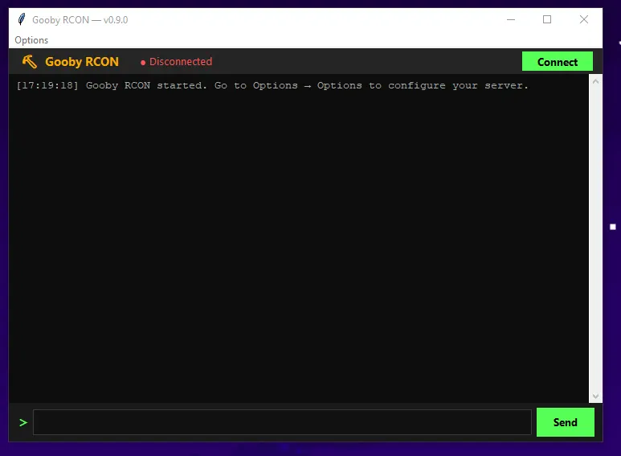

# Gooby_RCON

Gooby_RCON is a lightweight desktop client for connecting to a game server over the Source-style RCON protocol. It gives you a clean console-style interface for sending commands, reading server output, and managing a server without opening the full server GUI.

**Current Version:** 0.9.4

**Build Date:** 2026.08.15

## Project Setup

```pwsh
python -m venv venv
venv\Scripts\Activate.ps1
python -m pip install -r requirements.txt
```

Execute the following code block to build a PyInstaller .EXE

```pwsh
venv\Scripts\python -m PyInstaller --onefile --windowed --name Gooby_RCON --icon=icon.ico app.py
```

If PyInstaller fails with `WinError 5` or `Access is denied`, close any running `Gooby_RCON.exe` and delete the existing file in the `dist` folder before rebuilding.


